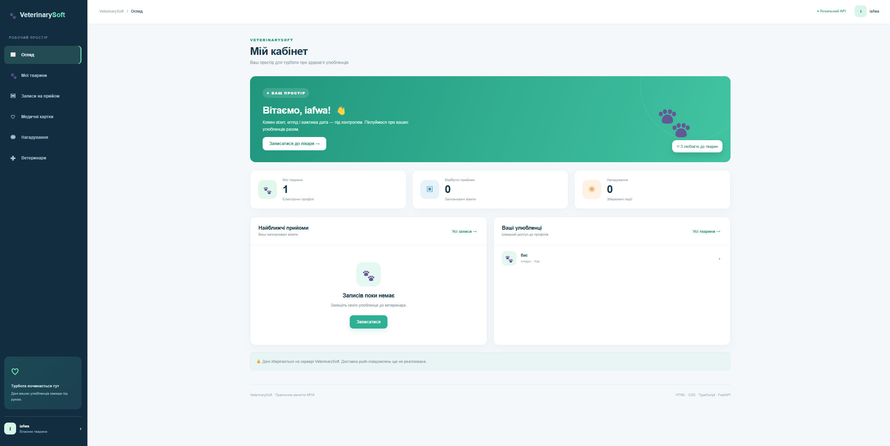
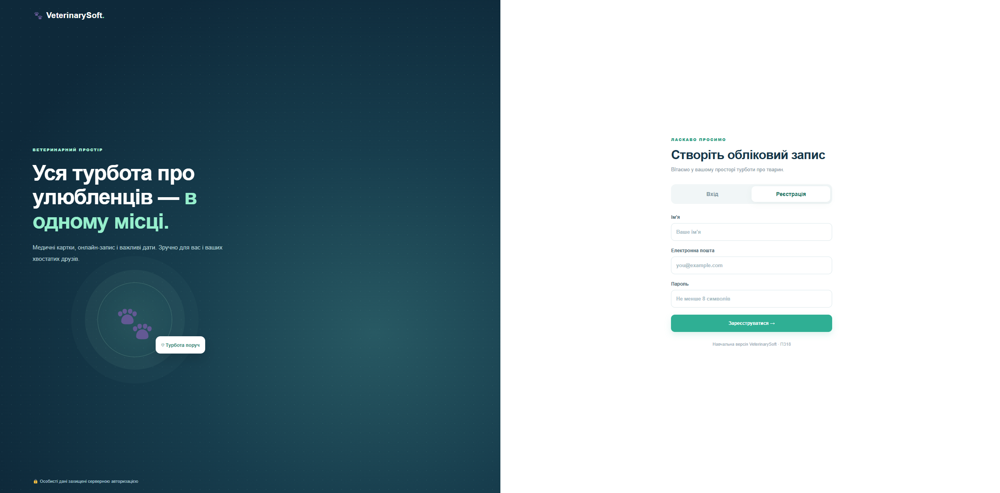
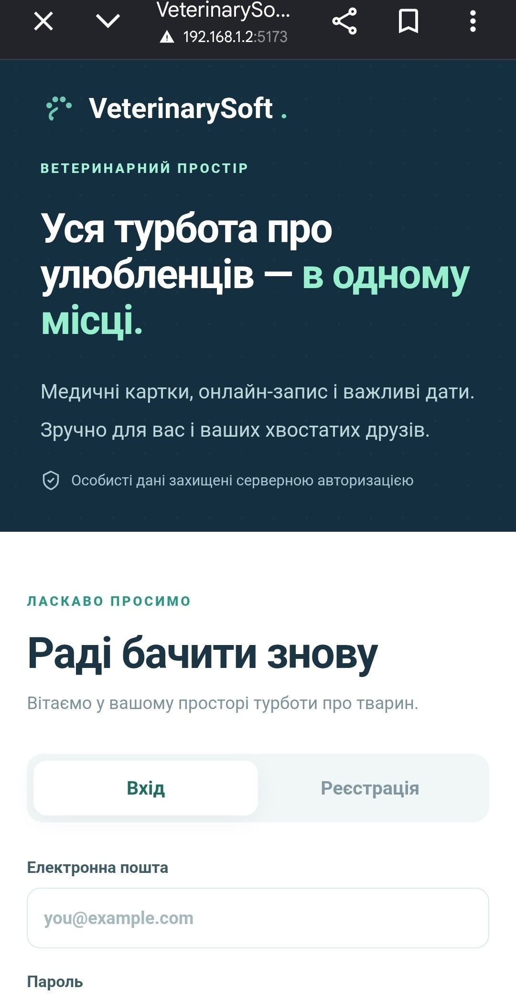

# VeterinarySoft - Frontend (Практичне завдання №18)

Навчальний адаптивний інтерфейс на HTML5, CSS3 та TypeScript, який працює із сервером VeterinarySoft (FastAPI + SQLite) із ПЗ16.

Backend: https://github.com/AnSi1910/VeterinarySoft-Backend

## Вигляд







## Що реалізовано

- Реєстрація власника тварини та вхід через FastAPI; JWT Bearer-токен.
- Головна сторінка з показниками, записами та переліком тварин.
- Створення і перегляд профілів тварин.
- Перегляд ветеринарів, створення та скасування прийомів.
- Адміністративні дії: додавання лікаря, підтвердження та завершення записів, створення медичного запису.
- Перегляд медичної історії та додавання/видалення нагадувань.
- Перегляд профілю, зміна імені, вихід.
- Реакція на помилки, успішні запити, стан завантаження, адаптивний дизайн.

Увага: push-повідомлення не доставляються - сервер ПЗ16 лише зберігає нагадування. Поточне API не містить графіка робочих годин лікаря, а доступність обраного часу перевіряється під час створення запису. Це навчальний прототип, не готовий сервіс для реальних медичних даних.

## Запуск

1. Запустіть Backend у терміналі папки `VeterinarySoft_Backend`:

```powershell
py -m venv .venv
.\.venv\Scripts\Activate.ps1
python -m pip install -r requirements-dev.txt
$env:VET_SECRET_KEY = python -c "import secrets; print(secrets.token_urlsafe(48))"
python -m uvicorn app.main:app --reload
```

Переконайтеся, що `http://127.0.0.1:8000/docs` відкривається.

2. Розпакуйте цей Frontend і відкрийте папку `VeterinarySoft_Frontend` у VS Code. У другому терміналі введіть:

```powershell
py -m http.server 5173
```

3. Відкрийте `http://127.0.0.1:5173/` у браузері. Можна увійти під обліковим записом, уже створеним у ПЗ16, або зареєструвати нового власника.

4. Щоб відкрити фронтенд зі смартфону, виконайте у Powershell:

`ipconfig`

У папці VeterinarySoft_Frontend введіть:

`py -m http.server 5173 --bind 0.0.0.0`

Відкрийте сайт у браузері:

`http://ВАША_IPv4_АДРЕСА:5173`

Папка `build/` уже містить готовий JavaScript - для першого запуску Node.js не потрібен.

## Компіляція при зміні TypeScript

Потрібен Node.js. Після редагування файлів `src/*.ts` виконайте:

```powershell
npm install
npm run build
```

Знову відкрийте / оновіть вебсторінку.

## Оформлення та редагування коду

У цій версії TypeScript, HTML і CSS відформатовані для читання та підтримки. Смайлики та емодзі в інтерфейсі замінено на SVG-іконки. Використано спокійну кольорову палітру, світлі блоки та мінімалістичне оформлення.

Після змін у `src/main.ts` або `src/api.ts` запускайте `npm run build`, щоб оновити файли `build/`. Скомпільований JavaScript теж включено до архіву, тому для першого запуску Node.js не потрібен.

## Структура

```text
VeterinarySoft_Frontend/
  index.html          точка входу
  styles.css          стилі та адаптивність
  src/api.ts          HTTP-запити, API, JWT, помилки
  src/main.ts         інтерфейс, маршрути, модальні форми
  build/              готовий JavaScript
  assets/             знімки екрана з демонстраційними даними
  tests/              список ручних перевірок
  tsconfig.json
  package.json
```

## Перевірка

У локальній збірці TypeScript пройшов `tsc` без помилок. Зображення інтерфейсу отримані в браузері з демонстраційними відповідями API, а не з реального сервера. Для перевірки роботи з вашими даними виконайте сценарій із `tests/manual-checklist.md`.

API URL у `src/api.ts` - `http://127.0.0.1:8000`. Backend із ПЗ16 повинен дозволяти CORS для `http://127.0.0.1:5173`. Для навчального локального запуску токен зберігається в `sessionStorage`; перед реальним розгортанням потрібні HTTPS і додаткові заходи безпеки.
